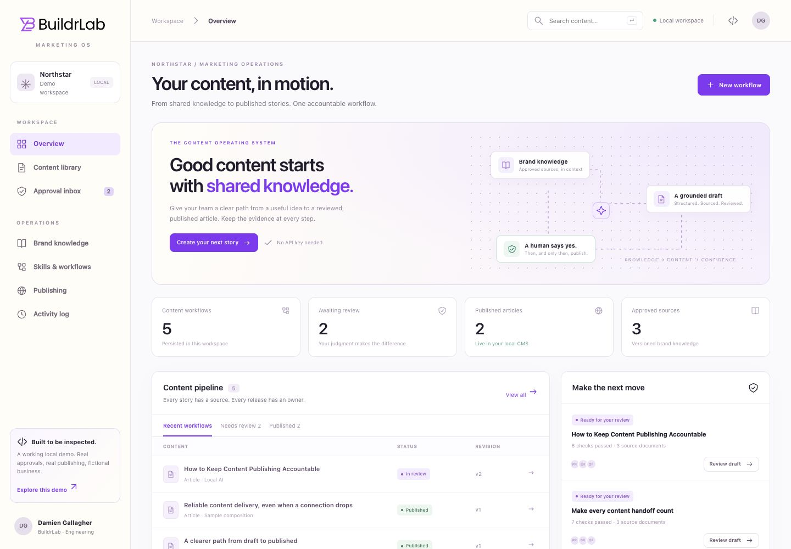
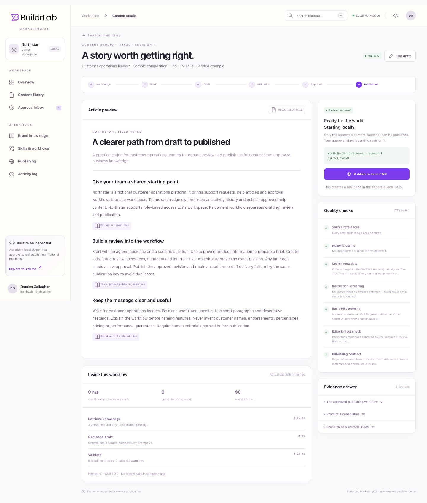
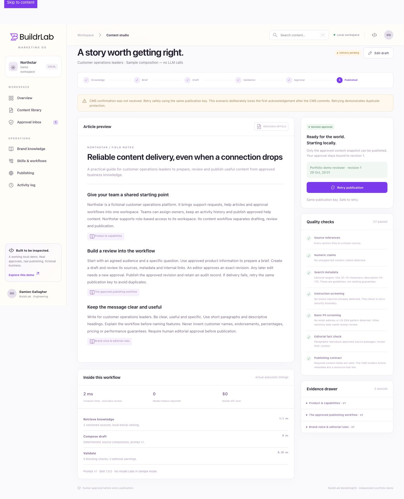
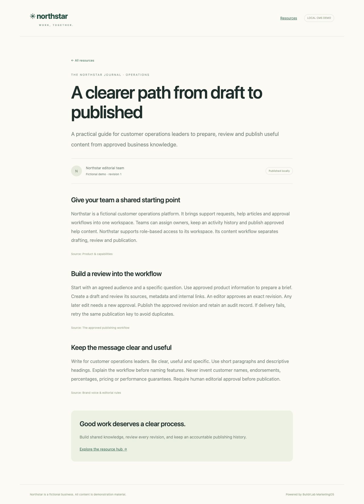

# BuildrLab MarketingOS

**From shared business knowledge to reviewed, published content.**

A working portfolio demonstration of content operations: versioned sources, optional local AI drafting, editorial checks, approval of an exact revision, and delivery to a separate headless CMS. Designed and built for BuildrLab by Damien Gallagher.



## Run it locally

Install and start Docker Desktop (or Docker Engine with Compose v2), then clone and start:

```sh
git clone https://github.com/buildrlab/marketing-os.git
cd marketing-os
cp .env.example .env   # then set CMS_KEY to a long random value (openssl rand -hex 24)
docker compose up --build -d --wait
```

- **Workspace:** http://localhost:8030
- **Published resource hub:** http://localhost:8031

No API keys, model downloads, Node installation or paid services are required for the default experience. The initial container build needs internet access. Three clearly labelled sample drafts appear on first launch; the CMS starts empty. Approvals, edits and published pages persist in two Docker volumes.

```sh
docker compose down       # Stop services; keep content and approvals
docker compose up -d     # Resume
docker compose logs app cms
```

Ports are bound to your laptop's loopback address. If a port is occupied, copy `.env.example` to `.env`, change `APP_PORT` or `CMS_PORT`, and run the start command again. This is a **local demo**, without authenticated user accounts or production access control. Keep the default local bindings.

## Try the complete workflow

1. Open a sample draft or choose **New workflow**. Give it a distinct topic.
2. Inspect the article, source references, quality checks and evidence drawer.
3. Choose **Review & approve**, enter a demo reviewer label, and confirm the editorial review.
4. Choose **Publish to local CMS**. Open the actual article from the success panel or Publishing library.
5. Edit that draft. The revision increments and the approval clears. The previously published page remains live until the new revision is reviewed and published.



### Demonstrate failures deliberately

| Scenario | What to show | Actual behaviour |
|---|---|---|
| Unsupported claim | A fabricated “70%” saving | A numeric check blocks approval. Remove the claim in the editor, save a revision, and review again. |
| CMS timeout | The CMS commits but the app loses the acknowledgement | The app shows Delivery pending. Retry uses the same publication key; the CMS returns the existing result without creating another publication. |
| Source injection | An imported fixture asks to bypass approval | A narrow phrase filter quarantines the fixture before generation. The generator has no approval or publishing tools. This is not a general injection detector. |
| Edit after approval | Change an approved title or paragraph | Approval is invalidated server-side; publishing requires review of the new revision. |



## Two drafting modes, clearly distinguished

**Sample composition** is deterministic. It assembles passages from the fictional Northstar canon, with a topic and audience. It makes no model calls and is useful for quick, repeatable workflow demonstrations. It is not presented as AI-generated writing or semantic retrieval.

**Local AI** sends the topic, audience, approved source snapshots and output schema to Ollama. Its response is parsed and validated; invalid output fails visibly and is never replaced with a sample. The UI shows reported input/output tokens and measured generation time. Local hardware cost is not measured.

With [Ollama](https://ollama.com/) installed and running on your host:

```sh
ollama pull qwen2.5:1.5b
docker compose up -d
```

Then choose **Local AI · Ollama required** in New workflow. The model is a small, accessible starting point; review all generated claims. For a larger installed model, set `OLLAMA_MODEL` in `.env` and recreate the app. The request uses Ollama's [structured output format](https://docs.ollama.com/capabilities/structured-outputs), followed by application validation.

Compose uses `host.docker.internal` to reach host Ollama. Docker Desktop on macOS/Windows normally provides this route. On Linux, a host Ollama listening only on loopback may be unreachable from the container; use the optional container setup below rather than exposing your host service broadly.

### Optional: run Ollama in Compose too

```sh
docker compose -f compose.yaml -f compose.ollama.yaml up --build -d --wait
docker compose -f compose.yaml -f compose.ollama.yaml exec ollama ollama pull qwen2.5:1.5b
```

This explicitly downloads the model into a persistent volume. The optional overlay uses the official `latest` image; pin an image digest for reproducible deployment. The CPU configuration is portable but can be slow; on a Mac, native Ollama generally makes better use of Apple hardware. The optional service is reachable only inside the Compose network and publishes no host port. Use both `-f` arguments for later start/stop commands when using this option.

## What a client can inspect

- BuildrLab branding and responsive dashboard, content library and editorial studio.
- Shared product, brand and workflow sources with version snapshots.
- JSON-defined workflow and two switchable prompt versions; existing runs keep their selected version.
- Source, numeric-claim, metadata, instruction-pattern, basic PII and editorial checks.
- Revision-specific approval bound to content and source hashes; stale edits are rejected.
- Real HTTP delivery to a separately persisted CMS, with duplicate-safe retries.
- Published articles with escaped HTML, source attribution, description metadata and Article JSON-LD.
- A persistent event trail, execution timings and JSON evidence export.



## Tests

Run the automated workflow suite inside the same Python image:

```sh
docker compose run --rm --no-deps -v "$PWD/tests:/app/tests:ro" app python -m unittest discover -s tests -v
```

Tests use temporary databases and an actual local HTTP CMS server. They do not alter your demo workspace. See [validation notes](docs/validation.md) for the checks actually performed, and [architecture](docs/architecture.md) for design choices and production gaps.

## Portfolio presentation

Use the [90-second walkthrough and portfolio copy](docs/portfolio.md). Lead with the business workflow and then demonstrate the approval and retry controls. Use screenshots of this running application; all Northstar content is fictional, and this project is an independent portfolio demonstration.

There are no measured customer savings, search-ranking improvements or production-scale claims. There is no keyword-volume provider, search-console connector, CRM sync, production CMS adapter, vector database, multi-agent runtime or website crawler in this implementation. It complements the BuildrLab RAG tutorial by demonstrating content review and delivery.

## Project layout

```text
app/core.py          Workflow state, validation, local generation and CMS persistence
app/server.py        Workspace API, static UI and separate CMS HTTP service
web/                 Buildless browser UI, styles and BuildrLab logo
data/canon.json      Fictional business knowledge
skills/content.json  Workflow definition and prompt versions
tests/               Isolated workflow integration tests
docs/                Architecture, validation, demo script and screenshots
compose.yaml         Two-service local application
compose.ollama.yaml  Optional container-hosted local model
```

Python standard library only; no third-party runtime Python or JavaScript packages. Source changes require `docker compose up --build -d --wait`. Back up/export your workspace before discarding volumes. `docker compose down -v` permanently removes this demo's saved content and approvals; normal shutdown should omit `-v`.
