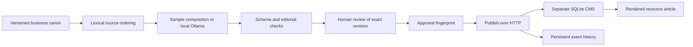

# Architecture and tradeoffs

## One useful vertical slice

The demo serves one fictional business, one article content type and one local CMS. The default path is deterministic source composition. An optional Ollama path generates a new structured draft. Both paths pass through the same application-controlled review and publishing state machine.

## State and approval

Drafts begin as `in_review` or `blocked`. Failing checks prevent approval on the server. A review note moves a draft to `changes_requested`. Approval records a reviewer label, timestamp, revision and SHA-256 fingerprint of content, source snapshots and version identifiers. The publisher recomputes that fingerprint before sending.

Edits use an expected revision. A stale editor or reviewer gets a conflict rather than overwriting another revision. Every edit increments the revision and clears approval. Previously published content remains available while its next revision is reviewed. Once published, the application keeps the URL slug stable.

The reviewer label is not identity verification. The prototype's HTTP routes have no login or reviewer role separation. Anyone with local access can approve a draft under a label. Add real authentication and server-side roles before using this with a team.

## Durable delivery

Each publication uses `content_id:rN` as its stable key. The CMS transaction inserts an immutable publication record and updates the current article. A retry with the same key and identical request returns the stored result. A different payload under that key, a conflicting article slug, or an unseen older revision is rejected.

The timeout fixture writes to the real CMS, then deliberately discards its acknowledgement in the application. This makes the ambiguous-outcome case reproducible without changing the CMS data. Retrying retrieves the existing result. Replaying a previously successful older key returns its historic receipt but does not revert the current article.

Application writes are serialized using an in-process lock, held during publication so an edit cannot race a publish within this process. This is deliberately a single-process implementation. A production version needs durable job records/outbox, database concurrency controls, bounded retry/backoff, reconciliation, and authenticated CMS credentials. The app and CMS databases do not share a transaction; the stable key handles repeat delivery, not every possible crash window.

## Grounding, checks and model behaviour

The canon contains three synthetic source documents. Source ordering uses lexical term overlap and supplies all three approved documents; this is not vector search. Each run stores its source snapshots. Future canon changes apply to new runs after rebuilding. Use new source/prompt versions for substantive changes; changing a prompt file in place under the same version defeats its provenance.

Ollama receives a JSON output schema with bounded fields and known source IDs. Application validation follows decoding. Schema conformance does not establish truth. Numeric matching can reject novel legitimate numbers and can miss an incorrect claim that happens to reuse a known number. Verbatim passage matching can still miss misleading context. Paraphrased output explicitly needs human verification.

The source-injection fixture is filtered before generation using a small known-phrase rule. The more important control is capability separation: generated text cannot call approval or publishing actions. This is not a complete prompt-injection defence. Basic privacy checks cover email addresses and a US SSN pattern only; production privacy needs a suitable detection/redaction policy and testing.

## CMS boundary

This repository implements a small headless CMS with a publishing endpoint, separate SQLite persistence, a resource hub and HTML articles. It does **not** claim integration with WordPress, Sanity, Contentful or another vendor. An adapter can replace the HTTP boundary while keeping approval and publication receipts in the workflow service.

The CMS trusts a shared application key and the approval envelope from that application; it does not independently authenticate a human reviewer. The default key is public demo configuration. HTML is escaped and user-supplied strings cannot inject executable markup. Article JSON-LD and description metadata are rendered server-side. Pages deliberately use `noindex,nofollow` because they contain fictional material.

## Before production

Add authenticated users and roles, tenant/source access controls, secret management, backup/restore procedures, a durable queue/outbox, rate and resource limits, structured operational monitoring and migrations. Introduce content quality evaluations with human reference judgments before claiming accuracy gains. Add an actual CMS adapter and test its draft, publish, update, timeout and permission semantics. Replace the standard-library development HTTP server with a supported deployment stack.

Do not advertise keyword demand research, search visibility improvements, hallucination prevention or enterprise scalability based on this small demo. Its evidence is a functioning local workflow and the tested state/delivery invariants.
